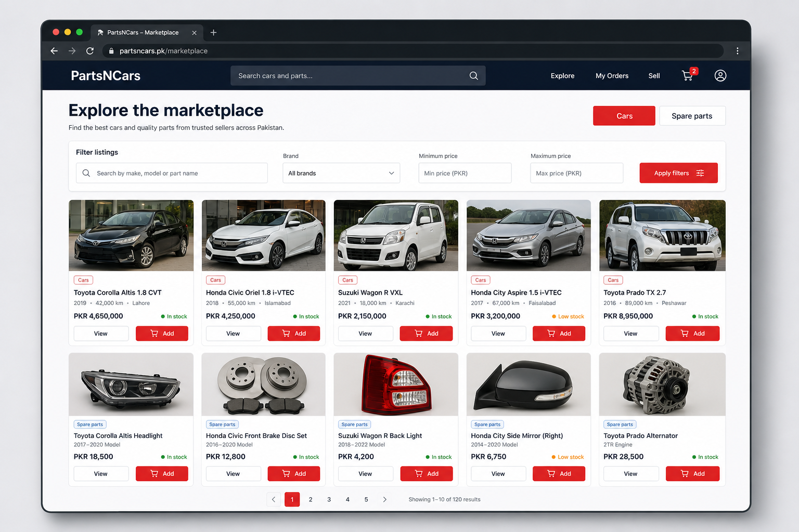
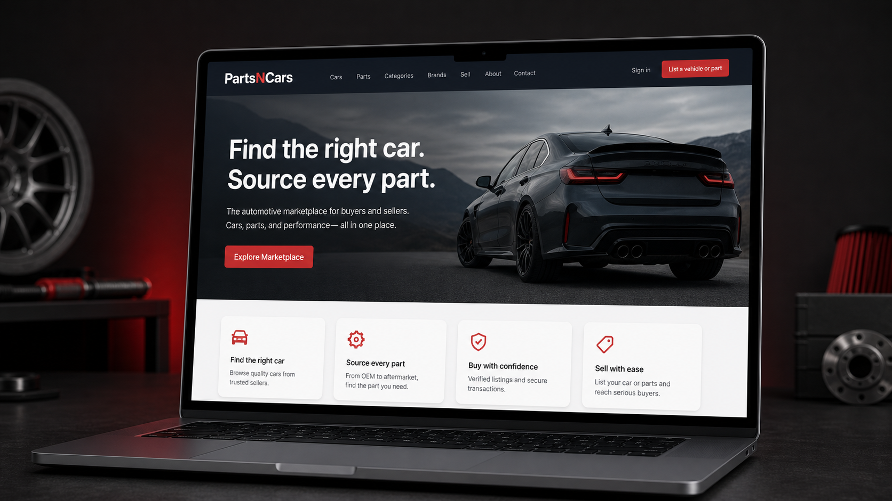
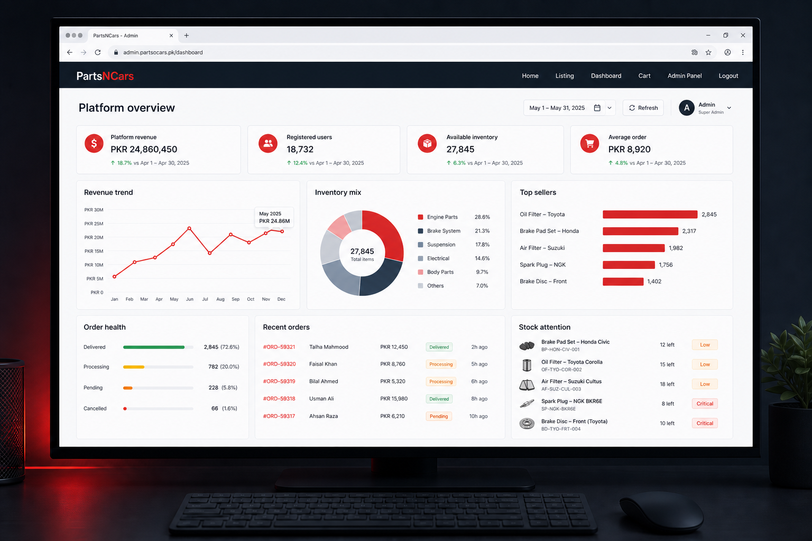
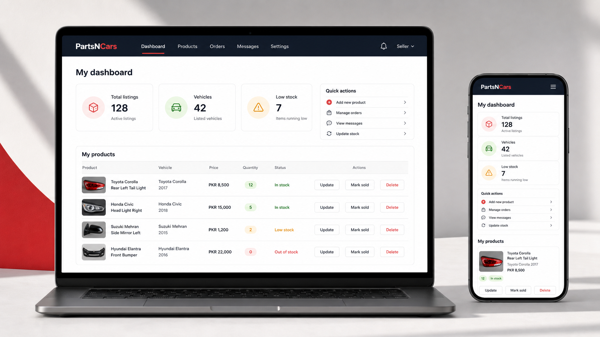

# PartsNCars

PartsNCars is a full-stack automotive marketplace for listing vehicles, buying spare parts, managing inventory, processing orders, and monitoring platform performance.



## Highlights

- Vehicle and spare-part marketplace with search and price filters
- Authentication and role-aware navigation
- Seller dashboard for listings, stock, purchases, and fulfillment
- Cart, cash-on-delivery, and Stripe checkout workflows
- Admin user, inventory, order, and transaction management
- Real-data admin charts for revenue, inventory, sellers, and order health
- CSV and PDF sales reporting
- Responsive layouts for desktop, tablet, and mobile
- Socket.IO updates for marketplace and dashboard activity

## Technology

- React 19 and React Router
- Bootstrap 5 and React-Bootstrap
- Express and MySQL
- Socket.IO
- Stripe Checkout
- jsPDF and CSV exports

## Local setup

1. Install dependencies:

   ```bash
   npm install
   ```

2. Copy `.env.example` to `.env` and enter your local database, JWT, and Stripe credentials.

3. Export the environment variables from `.env` in your shell, then start the backend:

   ```bash
   node backend/server.js
   ```

4. Start the React development server in another terminal:

   ```bash
   npm start
   ```

The frontend runs on `http://localhost:3000` and expects the API at `http://localhost:5000`.

## Validation

```bash
npm test -- --watchAll=false
npm run build
```

## Portfolio previews






